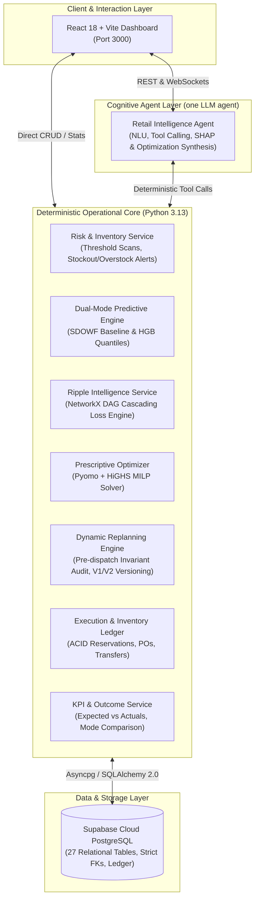

<div align="center">

# 🛒 RetailMind AI

### Explainable, Adaptive Multi-Agent Retail Decision Intelligence Platform

*From forecasting to autonomous execution — with a human in the loop.*


[Overview](#-overview) •
[Features](#-key-features) •
[Architecture](#-system-architecture) •
[Tech Stack](#-tech-stack) •
[Getting Started](#-getting-started) •
[API](#-api--endpoints) •
[Tests](#-testing)

</div>

---

## 📖 Table of Contents

1. [Overview](#-overview)
2. [Problem & Solution](#-problem--solution)
3. [Key Features](#-key-features)
4. [System Architecture](#-system-architecture)
5. [Tech Stack](#-tech-stack)
6. [How It Works](#-how-it-works)
7. [Getting Started](#-getting-started)
8. [API & Endpoints](#-api--endpoints)
9. [Testing](#-testing)
10. [AI Copilot](#-ai-copilot)
11. [Project Structure](#-project-structure)

---

## 🎯 Overview

**RetailMind AI** is an enterprise-grade, agentic supply-chain decision intelligence platform built for multi-store supermarket networks across Tamil Nadu — **Chennai, Coimbatore, Madurai, Tiruppur and Salem**.

Instead of stopping at passive forecasting, RetailMind AI closes the loop:

> **Observe** inventory → **Predict** quantile demand (P10 / P50 / P90) → **Diagnose** ripple effects → **Optimize** with MILP → **Ask** the manager through the web dashboard → **Execute** approved actions → **Replan** when conditions change.

<!-- Add a hero screenshot or GIF of the dashboard here -->
<!--  -->

---

## 💡 Problem & Solution

| The Problem | The RetailMind AI Approach |
| --- | --- |
| Stockouts and overstock across many stores | Quantile demand forecasts with per-store risk scanning |
| Forecasts that nobody acts on | MILP optimizer recommends the most profitable intervention |
| Supplier delays that silently cascade | Directed-graph ripple analysis down to net profit |
| Plans that go stale before the truck leaves | Pre-dispatch replanning with V1 → V2 versioning |
| LLMs are costly and unreliable for math | Deterministic core; LLMs only for language and explanation |
| Managers don't want another dashboard | Approvals through the web decision centre |

---

## ✨ Key Features

### 📈 Dual-Mode Demand Forecasting
- **Mode A — SDOWF (default):** Seasonal Day-of-Week + Festival model. Zero disk footprint, computes in under 1 ms. Captures the 14-day rolling baseline, weekend shopping peaks and Tamil Nadu festival surges (Pongal, Deepavali, Tamil New Year). Quantiles come from empirical residual uncertainty.
- **Mode B — HistGradientBoosting (precision):** Quantile regression trained on **160,600 sales records** across 88 SKUs, 5 stores and 12 months.

| Metric (Mode B) | Value |
| --- | --- |
| Validation R² | **0.918** |
| WAPE | **10.58 %** |
| MAE | **5.81** |

- **Model comparison API** benchmarks SMA-7, WMA-7, SES, SDOWF and HistGradientBoosting side by side.
- **Explainability** via SHAP TreeExplainer feature attribution.

### 🕸️ Ripple Effect Graph Intelligence
Supply chains are modelled as a directed graph (NetworkX):

```
Supplier → Product → Inventory Node → Store → Revenue → Net Profit
```

A supplier delay is traced through inventory burn, store stockout and lost margin automatically.

### 🧮 Prescriptive MILP Optimization
Pyomo + HiGHS evaluate six interventions and pick the most profitable one:

| Action | Purpose |
| --- | --- |
| `REPLENISH_SUPPLIER` | Standard or expedited purchase order |
| `INTER_STORE_TRANSFER` | Rebalance surplus from a neighbouring store (e.g. Coimbatore → Salem) |
| `ALLOCATION_CHANGE` | Redirect an incoming cross-dock shipment |
| `APPLY_MARKDOWN` | 10–30 % discount to clear stock before expiry |
| `PROMOTION_ADJUST` | Suppress promotions when inventory is scarce |
| `NO_ACTION` | Hold the baseline when intervention cost exceeds benefit |

Source-store safety stock is **mathematically guaranteed never to be violated**.

### Web-Based Decision Approvals
- Review, approve, or reject recommendations in the AI Decision Centre.
- Approval actions are recorded in the decision audit trail.

### 🔄 Dynamic Replanning Engine
Assumptions are re-validated before dispatch. *Example:* a Salem → Coimbatore transfer is approved (V1), then demand in Coimbatore spikes by 45 units before the truck leaves. The engine pauses V1, releases the stock reservations, re-optimizes, creates V2 and asks for fresh approval.

### 💸 >90 % LLM Cost Reduction
Risk scans, DAG cascades, optimization, button handling, stock reservations, order execution and replanning audits make **zero LLM calls**. The LLM is used only for conversation and plain-language explanation (~150–250 tokens per event).

---

## 🏗️ System Architecture

RetailMind AI uses a **two-layer decoupled architecture**:

1. **Deterministic Operational Core** (Python 3.13 + Math + SQL) — telemetry, risk detection, forecasting, graph cascading, MILP optimization, ledger transactions, replanning and KPI reporting. No LLM in any mission-critical calculation.
2. **Cognitive Agent Layer** (one LLM agent)
   - **Retail Intelligence Agent** — LangGraph + Groq brain for NLU, tool routing, grounded retrieval and SHAP/decision explanation.



---

## 🧰 Tech Stack

| Layer | Component | Technology |
| --- | --- | --- |
| **Backend** | Web framework | FastAPI (Python 3.13), async lifespan |
| | ORM & validation | SQLAlchemy 2.0 Async, Pydantic v2 |
| | Connection pool | AsyncAdaptedQueuePool (auto-recycle, pre-ping) |
| | Real-time | FastAPI WebSockets (`/ws/dashboard`) |
| **Database** | Engine | Supabase Cloud PostgreSQL 16+ |
| | Schema | 27 relational tables, strict FKs, inventory invariants |
| **Forecasting** | Modes | SDOWF (default) · HistGradientBoostingRegressor with quantile loss |
| | Explainability | SHAP TreeExplainer |
| **Optimization** | Graph | NetworkX directed dependency graph |
| | Solver | Pyomo + HiGHS (`appsi_highs`) |
| | Digital twin | SimPy + NumPy discrete-event simulator |
| **Agents** | Framework | LangGraph StateGraph |
| | LLM | Groq Cloud LPU (`openai/gpt-oss-120b`) |
| **Approvals** | Channel | Web dashboard decision centre |
| **Frontend** | App | React 18, Vite, Lucide Icons, Chart.js |

---

## 🔁 How It Works

```
1. OBSERVE   → Risk service scans multi-store inventory for stockout / overstock
2. PREDICT   → Quantile forecast (P10 / P50 / P90) per SKU per store
3. DIAGNOSE  → Ripple graph estimates downstream revenue and profit impact
4. OPTIMIZE  → MILP picks the most profitable of 6 interventions
5. PRESENT   → Show the recommendation and alternatives in the web dashboard
6. APPROVE   → Idempotent, version-locked approval
7. EXECUTE   → Ledger reserves stock, raises POs / transfers
8. REPLAN    → Pre-dispatch audit; if assumptions break, V1 → V2 and re-approve
9. MEASURE   → KPI service compares expected vs actual outcomes
```

---

## 🚀 Getting Started

### Prerequisites

- Python 3.11+ (3.13.5 tested)
- Node.js 18+ and npm
- Git
- A Supabase PostgreSQL project and a Groq API key

### 1. Clone the repository

```bash
git clone https://github.com/boomiikas/RetailMindAI.git
cd RetailMindAI
```

### 2. Configure environment

Copy `.env.example` to `.env` and fill in your credentials:

```env
APP_ENV=development
DEBUG=true
PORT=8000
HOST=0.0.0.0

# Database (Supabase Cloud PostgreSQL)
DATABASE_URL=""
SYNC_DATABASE_URL=""
DATABASE_ECHO=false

# Groq Cloud API
GROQ_API_KEY=your_groq_api_key_here
GROQ_MODEL=openai/gpt-oss-120b
LLM_PROVIDER=groq
LLM_TEMPERATURE=0.1


# Security & CORS
SECRET_KEY=change-me-to-a-long-random-string
ALLOWED_ORIGINS=http://localhost:5173,http://localhost:3000,http://127.0.0.1:5173
```


### 3. Install dependencies

```bash
# Create and activate a virtual environment
python -m venv .venv

# Windows (PowerShell)
.\.venv\Scripts\Activate.ps1
# macOS / Linux
# source .venv/bin/activate

# Backend
pip install -r requirements.txt

# Frontend
npm install
```

### 4. Run the backend

```bash
uvicorn backend.app.main:app --host 0.0.0.0 --port 8000 --reload
```

| Resource | URL |
| --- | --- |
| Swagger UI | http://localhost:8000/docs |
| ReDoc | http://localhost:8000/redoc |
| Health check | http://localhost:8000/health |
| WebSocket feed | `ws://localhost:8000/ws/dashboard` |

### 5. Run the frontend

In a separate terminal:

```bash
npm run dev
```

Open **http://localhost:3000**.

---

## 🔌 API & Endpoints

| Method | Endpoint | Description |
| --- | --- | --- |
| GET | `/health` | Service health check |
| GET | `/api/v1/dashboard/overview` | Executive dashboard overview |
| GET | `/api/v1/inventory` | Multi-store inventory list |
| GET | `/api/v1/forecasts` | Quantile demand forecasts |
| GET | `/api/v1/forecasts/compare-models` | Benchmark SMA-7, WMA-7, SES, SDOWF, HGB |
| POST | `/api/v1/chat` | Retail Copilot chatbot |
| WS | `/ws/dashboard` | Real-time dashboard stream |

Full interactive documentation is available at `/docs` when the server is running.

---

## ✅ Testing

The suite covers REST APIs, Groq integration, and end-to-end retail scenarios.

```bash
python -m pytest backend/tests/test_api_endpoints.py \
                 backend/tests/test_groq_integration.py \
                 backend/tests/test_retailmind_scenarios.py -v
```

<details>
<summary><b>View test coverage</b></summary>

| File | Scenario / Feature | Result |
| --- | --- | --- |
| `test_api_endpoints.py` | Health check | ✅ |
| `test_api_endpoints.py` | Executive dashboard overview | ✅ |
| `test_api_endpoints.py` | Multi-store inventory list | ✅ |
| `test_api_endpoints.py` | Quantile demand forecast | ✅ |
| `test_api_endpoints.py` | Model comparison benchmark | ✅ |
| `test_api_endpoints.py` | Retail Copilot chatbot | ✅ |
| `test_groq_integration.py` | Groq direct API completion | ✅ |
| `test_groq_integration.py` | Decision explanation with SHAP weights | ✅ |
| `test_groq_integration.py` | Store manager conversational Q&A | ✅ |
| `test_retailmind_scenarios.py` | S1: Stockout → Inter-Store Transfer | ✅ |
| `test_retailmind_scenarios.py` | S2: Overstock → Markdown Strategy | ✅ |
| `test_retailmind_scenarios.py` | S3: Supplier Delay → Ripple Analysis | ✅ |
| `test_retailmind_scenarios.py` | S5: Dynamic Replanning on Pre-Dispatch Spike | ✅ |
| `test_retailmind_scenarios.py` | S6: Duplicate / Idempotent Approval Rejection | ✅ |
| `test_retailmind_scenarios.py` | S7: Failed Execution with Error Handling | ✅ |
| `test_retailmind_scenarios.py` | S8: Baseline vs AI Prescriptive vs AI Agentic KPIs | ✅ |

</details>

---

## 🤖 AI Copilot

The dashboard includes a floating, real-time assistant grounded in live PostgreSQL data and powered by Groq (`openai/gpt-oss-120b`).

- **Answers:** inventory levels, stockout risks, quantile demand, store health, supplier lead times, pending decisions.
- **Guardrails:** politely declines off-topic prompts to keep responses focused and enterprise-safe.

---

## 📁 Project Structure

```
RetailMindAI/
├── backend/            # FastAPI app, services, optimizer, agents, tests
├── src/                # React + Vite frontend
├── .agents/skills/     # Agent skill definitions
├── index.html          # Vite entry point
├── vite.config.js
├── package.json
├── .env.example        # Environment template
└── README.md
```

---

</div>
